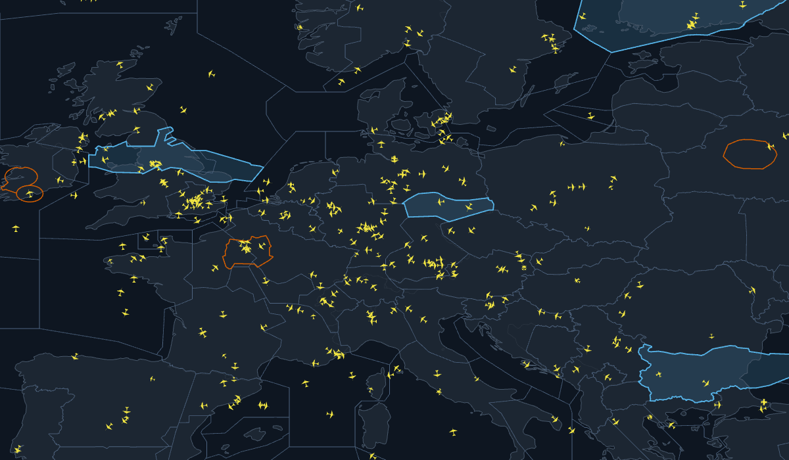

# RadarVector

**See the VATSIM network live, on a fast and clean map.**

RadarVector is a free desktop app for Windows, macOS and Linux that shows who is
online on [VATSIM](https://vatsim.net): air traffic controllers, flights in the
air and on the ground, airspace boundaries and airport weather. It updates
automatically, works smoothly even with thousands of aircraft, and is available
in English and French.



## Features

- **Live map**: aircraft oriented along their heading, staffed sectors and
  approach areas highlighted, airports showing which positions are open.
- **Controllers and flights lists**: sortable, searchable, with the columns you choose.
- **Details in one click**: flight plan, route and track of a flight; controllers,
  ATIS, departures, arrivals and METAR of an airport; traffic in a sector.
- **Search everything** with Ctrl+K (Cmd+K on Mac): callsign, CID, airport, sector.
- **Filters and favourites**: follow friends or airports, highlight what matters,
  get a desktop notification when they come online.
- **Map tools**: distance and bearing measurement, bookmarks with keyboard shortcuts.
- **Light and dark themes**, colour-blind friendly palette.
- **Always up to date**: boundary data and the app itself update automatically,
  and every app update is verified with a digital signature.

## Download

Get the installer for your system from the [Releases page](https://github.com/gmtherien/RadarVector/releases):

| System | File |
| --- | --- |
| Windows (x64, ARM64) | `…-setup.exe` or `.msi`, or the portable `.zip` |
| macOS (Apple Silicon and Intel) | `.dmg` |
| Linux | `.AppImage` or `.deb` |

## Your data

RadarVector only reads VATSIM's public data feeds. It needs no account and sends
nothing about you. Your settings, filters and favourites stay on your computer.

## Building from source

You need [Rust](https://rustup.rs). Then:

```bash
cargo run -p radarvector-app --release
```

See [docs/DEVELOPMENT.md](docs/DEVELOPMENT.md) for the project layout, tests and tools.

## Credits and licences

- RadarVector code: MIT OR Apache-2.0, at your option.
- Airspace and airport data: [community boundary data project](https://github.com/vatsimnetwork/vatspy-data-project),
  © its contributors, [CC-BY-SA-4.0](https://creativecommons.org/licenses/by-sa/4.0/).
- TRACON boundaries: [SimAware TRACON Project](https://github.com/vatsimnetwork/simaware-tracon-project),
  © its contributors, CC-BY-SA-4.0.
- Basemap: [Natural Earth](https://www.naturalearthdata.com) (public domain).
- Live data: VATSIM public data feeds.

RadarVector is an independent project, not affiliated with VATSIM.
